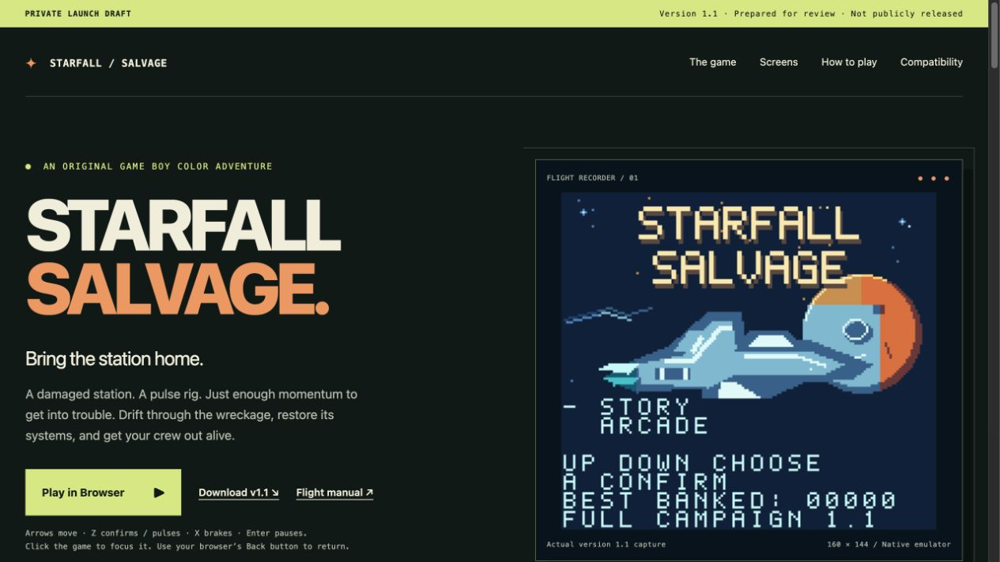

# Starfall Salvage 1.1

An original Game Boy Color adventure by Stephan Arrington, created with OpenAI Codex assistance. Thrust, drift and brake through a damaged station, restore its systems, escort the crew and recover guardian cores.

**Private release preparation.** This repository is an editable source snapshot and a place to review player materials. Keep it private until the remaining playtests, licensing decisions and release review are complete. It does not deploy a website or publish a release automatically.

Story contains 18 missions across six zones and 72 large scrolling rooms. Arcade repeats 12 compact room templates with changing hazard pressure and replacement pulse rigs. The native game is GBC-only; it uses a 1 MiB MBC5 ROM and 32 KiB battery-backed save RAM.

## Review the player download and launch draft

- [Native player ZIP, version 1.1](release/starfall-salvage-1.1-player.zip) — 4.34 MB; eight player-facing files, one ROM.
- [Illustrated manual](release/player-v1.1/INSTRUCTIONS.pdf) and [quick start](release/player-v1.1/QUICK-START.txt).
- [Private owner-only site](https://starfall-salvage.steph4n1.chatgpt.site) and [local launch-page draft](launch-page/README.md) — Play in Browser, genuine screenshots, downloads, instructions and tested/untested compatibility.
- [Remaining public-release work](docs/PUBLIC-RELEASE-PLAN.md).



To view the page locally, run this from the repository root:

```sh
python3 -m http.server 8080 --bind 127.0.0.1 --directory launch-page/dist
```

Then open `http://127.0.0.1:8080/`. Use the local server for the browser game; opening its HTML directly as a file does not load it reliably. The Sites project is also deployed with authorized owner-only access. The Play in Browser button opens the unmodified official export bundled under `play/`. Its canonical nine files are in `release/browser-v1.1`; they match the exact ROM/runtime used for the complete browser campaign. Browser files remain separate from the native player ZIP. Saves stay in each browser at its site address and do not sync across devices. The site button, keyboard controls and ordinary-reload checkpoint recovery passed a [local integration check](docs/SITE-PLAY-VERIFICATION.json).

To repackage the frozen player files with Python 3 (standard library only):

```sh
python3 scripts/package-player-release.py
```

This reproduces the checked-in ZIP from the reviewed payload; it does not compile the game. The helper checks exact payload and ZIP hashes and refuses unreviewed changes. The approved ZIP hash and payload identities are recorded in the [release manifest](release/release-manifest.json). Review and update those inputs when preparing a future version. Use the release synchronization commands below to refresh matching site downloads and metadata after an approved package update.

## Keep updates synchronized

The [release manifest](release/release-manifest.json) binds the reviewed ROM, source snapshot, manual, player documents and genuine screenshots. The site uses the same release metadata. Edit canonical sources and run:

```sh
python3 scripts/sync-release.py sync
python3 scripts/sync-release.py check
python3 scripts/test-release-sync.py
```

Changed review inputs stop preparation until the required review is recorded. Sync never approves a new ROM, manual or screenshot automatically. GitHub Actions runs checks only; it cannot deploy. See [the update workflow](docs/RELEASE-WORKFLOW.md) and [project instructions](AGENTS.md).

The Sites project identity is retained in [the hosting manifest](launch-page/.openai/hosting.json). Reuse it for saved versions and authorized owner-only deployments. [The Sites version and source receipt](docs/SITES-DRAFT.json) records the delivered version; prepare a new saved version after site updates. Keep the site owner-only and GitHub private. No public website, GitHub Pages deployment or public release is authorized by a consistency check.

## Controls

| Action | Handheld | Browser edition defaults |
| --- | --- | --- |
| Thrust; release to drift | D-pad | Arrow keys |
| Pulse a nearby enemy; confirm a menu choice | A | Z |
| Brake/interact; back or cancel in menus | B | X |
| Pause/resume | Start | Enter |
| Open exit options during play | Select | P or Shift |

Use Up/Down to highlight menu choices and A to confirm. At the flight deck, Up/Down selects a mission and Left/Right chooses an unlocked rig. B has no action at the title. Finish the room objective, then return beside the actual dock terminal. Guardians require three separate pulses during CORE OPEN, collection of their released cores, and docking.

## Edit and build

Open `project.gbsproj` in GB Studio with `project/`, `assets/` and `plugins/` together. The snapshot includes all 653 distributed project resources and the custom native engine code. See [build notes](docs/BUILDING.md) before regenerating assets or changing toolchains. The project metadata still says format 4.2.0/release 10; it was preserved without migration.

A fresh clone compiled both native and browser exports on macOS arm64 with the recorded toolchain. All ROM bytes matched their frozen counterparts except GB Studio's built-in save signature and global checksum; all eight non-ROM browser files matched exactly. Two builds with deeper temporary paths failed at linking; a fresh short `/tmp` directory was the verified workaround. [The clean-build receipt](docs/CLEAN-BUILD.json) retains successes, failures and exact hashes. This establishes the recorded local build comparison, not byte-for-byte reproducibility or a cross-machine build qualification.

The [editable manual](campaign/full-length-packaging-stage/INSTRUCTIONS.md) covers objectives, controls, saves and installation. Its [generator instructions](campaign/full-length-packaging-stage/README.md) explain how to rebuild PDF, HTML and Markdown. Original illustrated cover art is in `artwork/box-art.png`; it is not a gameplay screenshot.

## Verified release and remaining checks

The exact native 1.1 ROM completed a fresh 18-mission / 72-room emulator run with Rank B and a displayed clear time of **35:27**. This guided functional time counts successful-room gameplay and excludes menus, pauses and failed attempts. It is not an expected first-time human completion time.

The separately identified browser export completed all 18 missions, 72 rooms, 18 guardians and seven escorts in Codex's in-app browser, reaching **42:41, Rank B**. The guided run included failed attempts, ordinary retries and one visible Saved states recovery to already-earned progress. Restarting through the preview's **Restart game** control produced a fresh title, and Continue restored the same ending from browser-stored SRAM. Normal page reload also recovered the ending through the plugin's separate emulator-state mechanism. This browser timer is separate from the native result and excludes menus, pauses and failed attempts. See [the browser verification receipt](docs/BROWSER-VERIFICATION.json) for its exact ROM/runtime and scope.

Human enjoyment and pacing, actual audio listening, physical Chromatic play, native cold-save persistence, full browser-process termination, the final public browser host, and cross-machine builds remain open checks. [Verification scope](docs/VERIFICATION.md) records the tested hashes and limits. Private local recordings, saves, firmware experiments and historical releases are deliberately outside this source repository.

## Credits and licensing

See [credits](CREDITS.md), [retained GB Studio notice](LICENSE) and [licensing status](docs/LICENSING.md). The original game's public licensing and distribution terms remain undecided. Preparing this private repository does not assign new license terms to the game or its assets.
