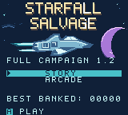
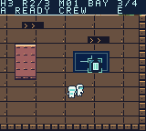
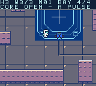
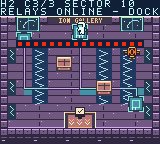
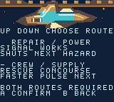
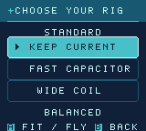

# Starfall Salvage 1.2

**Thrust. Drift. Salvage.**

An original Game Boy Color adventure by Stephan Arrington, created with OpenAI Codex assistance. Drift through a damaged station, restore its systems, guide stranded crew to safety and pulse guardian cores when they open.

**18 Story missions · 72 scrolling rooms · 6 zones · 4 pulse rigs · 12 repeating Arcade maps**

[**Download player ZIP**](release/starfall-salvage-1.2-player.zip) · [Illustrated manual (PDF)](release/player-v1.2/INSTRUCTIONS.pdf) · [Quick start](release/player-v1.2/QUICK-START.txt) · [Release notes](release/player-v1.2/RELEASE-NOTES.txt) · [Website](https://starfall.steph4n.dev) · [Play in Browser](https://starfall.steph4n.dev/play/)

**Version 1.2 is available to play and download.** Native Story and Arcade have complete recorded runs; browser checks cover two Story missions and one Arcade sector. See [verification scope](#verification), [delivery records](docs/HOSTED-VERIFICATION.json) and the [release checklist](docs/PUBLIC-RELEASE-PLAN.md) for the tested artifacts and remaining checks.

## Screenshots

Six unmodified captures from the exact native 1.2 ROM in PyBoy, displayed at twice their 160 × 144 resolution. These are emulator captures; [the screenshot manifest](campaign/full-length-packaging-stage/assets/screenshots/SCREENSHOTS.json) records their hashes and provenance.

<table>
  <tr>
    <td align="center">
      
      <br><strong>Ready for launch</strong><br>The native title screen, captured during its ship and star animation.
    </td>
    <td align="center">
      
      <br><strong>Bring the crew home</strong><br>Stay close and guide the crew member back to the dock.
    </td>
  </tr>
  <tr>
    <td align="center">
      
      <br><strong>Wait for the opening</strong><br>Pulse the guardian while its core is exposed.
    </td>
    <td align="center">
      
      <br><strong>Time the crossing</strong><br>The Ion Gallery's active beam cuts across the room.
    </td>
  </tr>
  <tr>
    <td align="center">
      
      <br><strong>Choose your route</strong><br>Clear both bays; their order changes the next bay's conditions.
    </td>
    <td align="center">
      
      <br><strong>Keep your rig or refit</strong><br>Arcade rig changes are optional. B returns to the dock.
    </td>
  </tr>
</table>

## What's new in 1.2

- Clearer menus with cyan selections, centered headings and A/B button badges. Flight Deck and dock cards preview the next objective; Pause repeats the current one.
- Faster departures: **Fly On** keeps the current Arcade rig, **Change Rig** is optional, and **Bank Haul** secures the score. Story route choices and ordinary **Bay Secured** cards continue directly with A.
- An animated native title with ship, stars, exhaust and an original theme. There is no intro to wait through.

Movement, combat, objective rules, scoring and rig effects retain their existing design. See the [release notes](release/player-v1.2/RELEASE-NOTES.txt) for the complete changes.

## Play

The [player ZIP](release/starfall-salvage-1.2-player.zip) includes `Starfall-Salvage-1.2.gbc`, the reviewed fourteen-page manual, quick start, release notes, credits, retained license notice and checksums. The native game is **GBC-only**, with a **1 MiB MBC5 ROM and 32 KiB battery-backed save RAM**. The owner confirmed that **1.2 works on Chromatic with an SD flash cartridge**. Follow the [quick start](release/player-v1.2/QUICK-START.txt) for emulator and cartridge requirements; other configurations and full power-off-save behavior need their own checks.

The [browser edition](https://starfall.steph4n.dev/play/) runs the official 1.2 export. Recorded live ZIP and PDF downloads matched the canonical files byte for byte, and all eight ZIP entries passed CRC checks. [Delivery details](docs/HOSTED-VERIFICATION.json) identify the tested deployment; the [launch-page workflow](launch-page/README.md) describes how the site is maintained. Delivery checks are separate from gameplay qualification.

To view the currently generated site locally:

```sh
python3 -m http.server 8080 --bind 127.0.0.1 --directory launch-page/dist
```

Open `http://127.0.0.1:8080/`. Use a local server for browser play. The Play in Browser button opens the official export under `play/`; browser files remain separate from the native player ZIP. Progress stays in each browser at its site address and does not sync across devices. The generated site must be refreshed only after the release review gates pass.

## Controls and saves

| Action | Handheld | Browser edition defaults |
| --- | --- | --- |
| Thrust; release to drift | D-pad | Arrow keys |
| Pulse a nearby enemy; confirm a menu choice | A | Z |
| Brake/interact; back or cancel in menus | B | X |
| Pause/resume | Start | Enter |
| Open exit options during play | Select | P or Shift |

Use Up/Down to highlight choices and A to confirm. At the flight deck, Up/Down selects a mission and Left/Right chooses an unlocked rig. After confirming a launch, release and press A again when you want to pulse. B has no action at the title; in Pause it resumes, from Change Rig it returns to the dock, and at the Arcade dock it opens exit options without banking.

Finish the room objective, then return beside the actual dock terminal. Guardians require three separate pulses during CORE OPEN, collection of their released cores and docking. Both Story middle bays are required: power first disables the other bay's hazard; supply first speeds pulse recharge there.

Before upgrading, **back up the existing ROM and battery save**. Use your emulator or cartridge's normal save import/export or association process to connect a copy with `Starfall-Salvage-1.2.gbc`. Some setups match saves by ROM basename; a new filename does not automatically migrate progress. Keep the original backup until Continue restores the expected checkpoint and a new save/reopen check succeeds. Continue restores a saved stage or room-entry briefing, not a mid-room position. An unfinished Arcade sortie has no persistent resume point.

## Keep updates synchronized

The [release manifest](release/release-manifest.json) binds the reviewed ROM, source snapshot, manual, player documents and genuine screenshots. Edit canonical sources and run the release checks after the new evidence is accepted:

```sh
python3 scripts/package-player-release.py
python3 scripts/sync-release.py sync
python3 scripts/sync-release.py check
python3 scripts/test-release-sync.py
```

Packaging reproduces the declared player payload; it does not compile or qualify the game. Changed review inputs stop preparation until the required review is recorded. Sync never approves a new ROM, manual or screenshot automatically. GitHub Actions runs checks only. See [the update workflow](docs/RELEASE-WORKFLOW.md) and [project instructions](AGENTS.md).

Reuse the existing Sites identity in [the hosting manifest](launch-page/.openai/hosting.json) for saved versions and release deployments. [The Sites receipt](docs/SITES-DRAFT.json) records the delivery identity and publication status. Keep the public website synchronized with the reviewed release artifacts.

## Edit and build

Open `project.gbsproj` in GB Studio with `project/`, `assets/` and `plugins/` together. The snapshot includes the project resources and custom native engine. See [build notes](docs/BUILDING.md) before regenerating assets or changing toolchains. Project metadata retains format 4.2.0/release 10 without migration.

The earlier 1.1 clean-clone comparison compiled native and browser exports on macOS arm64. Generated save-signature and checksum bytes varied; all other compared ROM/runtime bytes matched. A short `/tmp` build directory worked around failures with deeper paths. [The receipt](docs/CLEAN-BUILD.json) retains that version's results. Separate 1.2 clean-clone and cross-machine reproducibility have not been established.

The [manual generator](campaign/full-length-packaging-stage/generate_manual.py) is the content source. Its [instructions](campaign/full-length-packaging-stage/README.md) describe the final-hash, screenshot and review gates. The 1.2 PDF, HTML and Markdown are generated from the accepted receipts and captures; [all fourteen PDF pages were visually reviewed](docs/MANUAL-REVIEW.json). The illustrated cover in `artwork/box-art.png` is artwork, not a gameplay screenshot.

## Verification

| Recorded check | Completed coverage | Evidence |
| --- | --- | --- |
| Native Story | 18 missions, 72 rooms, 18 guardians and seven rescues; 31:26, Rank B. One M17 failure recovered through ordinary Retry. | [Native receipt](docs/NATIVE-VERIFICATION.json) |
| Native Arcade | All 12 sectors, no retries, 22,500 banked; same-session Continue restored the completed Story checkpoint. | [Native receipt](docs/NATIVE-VERIFICATION.json) |
| Browser gameplay | M01/M02: eight Story rooms, two guardians and one escort; Arcade S01 and 300 banked after retry. Menu, rig and reload checks passed. | [Browser receipt](docs/BROWSER-VERIFICATION.json) |
| Hosted delivery | Controls, actual 1.1-to-1.2 M01 checkpoint upgrade, ordinary reload/Continue and exact ZIP/PDF downloads at the custom origin. | [Hosted receipt](docs/HOSTED-VERIFICATION.json) |
| Owner hardware report | 1.2 play confirmed on Chromatic with an SD flash cartridge. | Owner report; see [verification notes](docs/VERIFICATION.md) |
| Visuals and manual | Eleven native captures and all fourteen manual pages reviewed; nine embedded images match canonical capture pixels. | [Manual review](docs/MANUAL-REVIEW.json) |

These are guided ordinary-input runs. The Story timer counts successful-room gameplay and excludes menus, pauses and failed attempts; it is not a first-time human completion estimate. Browser coverage does not establish a full campaign, complete Arcade cycle or browser clear time. Same-session native Continue and ordinary browser reload are narrower than cold-start or full-process restart tests.

**Remaining checks:** native cold-start saves, full browser-process termination, heard speaker/headphone audio, full power-off-save behavior, independent hardware verification and additional cartridge/device configurations, other browsers, and uncoached human duration or enjoyment. Separate 1.2 clean-clone and cross-machine build comparisons also remain outstanding.

The [full verification notes](docs/VERIFICATION.md) retain failures, save boundaries and historical 1.1 results. Earlier playthroughs and the owner's informal 1.1 Chromatic report remain tied to that version.

## Credits and licensing

Game by **Stephan Arrington**, with OpenAI Codex assistance. See [credits](CREDITS.md) for the tools and retained notices.

**License scope:** [LICENSE](LICENSE) is the retained **GB Studio MIT notice**. Published by Stephan Arrington for public download and play; original-contribution reuse terms have not been separately specified. The retained notice does not assign MIT terms to those original contributions. See [licensing status](docs/LICENSING.md) for details.

Report bugs or share feedback through [GitHub Issues](https://github.com/steph4n-gh/starfall-salvage/issues).
