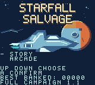
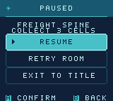
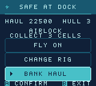
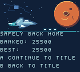
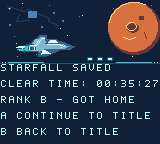

# Starfall Salvage 1.1 - Full Campaign Flight Manual

Game version 1.1. Documentation revised 2026-10-14.

A Game Boy Color adventure by Stephan Arrington.

Cover: original illustrated box art, not a gameplay frame.

## Welcome aboard

An original Game Boy Color adventure by **Stephan Arrington**. Pilot a salvage astronaut through a damaged station: thrust, drift, brake, restore its systems and bring the recovered cargo home.

> **Explore the full campaign:** 18 missions across six zones, with 72 large scrolling rooms, plus a separate repeating 12-room Arcade route. Choose your jobs, build a route and bring the salvage home.

### Your first flight

**1. Choose Story.** At the title use Up/Down to highlight Story or Continue, then A to confirm. Select Arcade the same way. B goes back or cancels where a previous screen exists; it has no action at the title.

**2. Choose a job and rig.** Up/Down selects a mission; Left/Right selects an unlocked pulse rig. Press A to launch.

**3. Read the room briefing.** It names the objective and threat. Press A when ready. B goes back; leaving an unfinished Arcade run asks for confirmation.

**4. Fly the objective.** Tap a direction to gain momentum. Release to drift; hold B to brake. Press A for a ready close-range pulse.

**5. Deliver.** After completing the objective, return beside the real dock terminal. Delivery is automatic. In large rooms the dock is a specific safe area, not the entire bottom edge.

Native 1.1 emulator capture: choose a mode with Up/Down, then press A. The title footer identifies the game version.

## Controls and drift

| Handheld | Browser default | Action |
| --- | --- | --- |
| D-pad | Arrow keys | Thrust in play; Up/Down chooses in menus |
| A | Z | Pulse in play; confirm selection in menus |
| B | X | Brake/interact in play; back/cancel in menus |
| Start | Enter | Pause and resume |
| Select | P / Shift | Open exit options during play |

Browser keys match the supplied game export. Click the game area to focus it, or use the on-screen controller. Follow the displayed controls if you choose a different emulator or remap its keys.

### Make momentum work for you

Thrust builds speed rather than moving your astronaut instantly. Releasing the D-pad leaves a drift. Start braking **before** a corner, then steer out of it. B also permits slower, more precise movement while held.

A pulse checks nearby enemies when you press A. Watch **A READY / A WAIT**; holding A does not repeatedly fire. Keep enough space to evade before spending a pulse.

### Read the HUD

**H** is your hull, initially three points. The objective counter tracks cargo or nodes; in escort rooms **R** shows crew hull. M is the mission and BAY is the room within that mission. Direction hints point toward the next target, crew route or dock.

> A card appears after launch, docking or failure. Give it a moment to settle, then release and press the intended button. A held brake is not a queued menu choice.

## Salvage, relays and repair

### Salvage: approach all three

Cells, shards and beacons collect automatically when your astronaut drifts within their close range. Recover all three, then return beside the dock terminal. Merely approaching the dock before the objective is complete does not clear the room.

### Ordered relays: the flashing node

Find the currently flashing node and hold **B continuously for 30 eligible gameplay updates** while within 12 pixels. Activate the three nodes in their indicated order. The HUD shows NODE and the current hold count.

Releasing B or leaving the active node resets its partial hold. Another node cannot be activated early. Once all three are online, return to the dock.

### Repair: any unfinished station

Hold **B continuously for 45 eligible gameplay updates** within 12 pixels of an unfinished station. Repair all three in any order, then dock. You can choose the station order that gives the safest route around the enemy.

Release B, move away, or switch to another station and the partial hold resets. Completed stations remain completed within that attempt. Paused time does not advance these counters.

| Interaction | Required hold | Order |
| --- | --- | --- |
| Relay | 30 eligible updates | Flashing node only |
| Repair | 45 eligible updates | Any unfinished station |
| Optional gold cache | 20 eligible updates | One mission badge |

> These counts are gameplay updates, not a promise about wall-clock time on every emulator or device. Brake beside the station and read the live HUD.

## Crew and guardian encounters

### Escort: stay close, then bring both home

The crew is a physical actor with **two hull points**. It follows its authored route only while you remain within **24 pixels**. Moving farther away stops it. Stay nearby to guide it through all three real route markers.

Enemy charges and active floor hazards can hurt the crew. Defend it with a ready pulse and use cover. To wait before a dangerous crossing, move out of follow range while the crew is still on safe floor, then regroup when the route clears.

The third marker alone is insufficient. The crew must finish its full route at the dock, and **your astronaut must also return beside the terminal** to deliver. Losing the crew ends the attempt; retry restores it.

### Guardian: three separate openings

Every mission ends with a guardian that has **three shield points**. Evade its committed dash, then close in while the HUD says **CORE OPEN**. A pulse within your rig radius removes one point, at most once per opening.

Pulsing outside OPEN can stun the guardian but does not damage its shield. After the third successful hit it releases three collectible cores: recover them and dock to finish the mission.

Native 1.1 emulator capture: the crew follows your astronaut through the room.

Native 1.1 emulator capture: CORE OPEN - A PULSE marks the guardian damage window.

## Enemies, hazards and safe docks

| Threat | Read it | Your response |
| --- | --- | --- |
| Charger | Amber locks a straight dash | Leave the aimed line; return during recovery |
| Sweeper | Locks one horizontal or vertical axis | Cross its locked axis; use solid cover |
| Hunter | Moves between dashes; targets crew in escort | Keep space and protect the crew route |

A drone damages actors during its **red charge**. Amber warning, ordinary recovery and cyan stun are approach windows. A charge can stop against solid cover. In a guardian room, use the explicit CORE OPEN status for damage opportunities.

### Floor colors are a clock

Dim vent or beam markings are safe. **Amber warns; red is active and damaging.** Floor cycles begin after the first completed objective marker, or at launch for a guardian. Wait on safe floor rather than drifting into a red lane.

Your pulse affects the enemy. It does not turn off floor hazards. The mission power-route perk can disable the second middle room's hazard before you enter it.

### The dock protects; the room still matters

In Story, only the area beside the actual terminal is the safe dock. The classic small Arcade maps use their bottom dock strip. Stay near the terminal when delivering; the lower edge of a scrolling room is not a universal safe lane.

Your astronaut and the crew briefly resist repeat damage after a hit. At zero astronaut hull, or zero crew hull in escort, the room attempt fails.

> Story repairs your astronaut to three hull points on room entry, retry and successful delivery. Completed earlier rooms and the current mission route remain at their checkpoint.

## Pulse rigs and route choices

| Rig | Radius | Reload | Stun | Tradeoff |
| --- | --- | --- | --- | --- |
| Standard | 24 px | 120 | 60 | Balanced default |
| Fast Capacitor | 20 px | 72 | 30 | More shots; closer range and shorter stun |
| Wide Coil | 36 px | 180 | 60 | Reach farther; wait longer |
| Overcharge | 24 px | 180 | 90 | Longer stun; wait longer |

Reload and stun are eligible gameplay updates. At an ideal 60 updates per second, 120 is about two seconds. Rigs **replace** one another; they do not stack. A guardian still allows only one shield hit per opening.

| Unlock | First mission clear |
| --- | --- |
| Wide Coil | 01 - Salvage Signal |
| Fast Capacitor | 02 - Bulkhead Circuit |
| Overcharge | 09 - Heat Grid |

### Choose which middle room comes first

After the arrival room, use **Up/Down to choose a route, then A to confirm**. Taking the power route first disables the supply route's hazard. The power route may itself be a repair or relay room; read its briefing.

Taking the **supply route first** shortens pulse reload in the power route to at most 72 updates. The selected rig's radius and stun remain unchanged. You must complete both routes before the guardian. B returns to the title with the checkpoint retained.

Mission-board Left/Right selects unlocked rigs. The Arcade workbench uses Up/Down and A; B returns to the dock.

Native 1.1 emulator capture: the highlighted route explains the benefit of taking it first.

## Six zones, eighteen jobs

In each zone, its **two regular jobs may be chosen in either order**. Clear both to unlock its final job. Clearing that third job opens the next zone. Each job has four large rooms: arrival, both middle routes, then guardian and extraction.

| Job | Zone | Mission | Access |
| --- | --- | --- | --- |
| 01 | Wreck Hull | Salvage Signal | Regular job |
| 02 | Wreck Hull | Bulkhead Circuit | Regular job |
| 03 | Wreck Hull | Rescue Passage | Final job |
| 04 | Coolant Works | Pressure Network | Regular job |
| 05 | Coolant Works | Crew Transfer | Regular job |
| 06 | Coolant Works | Coolant Restart | Final job |
| 07 | Solar Foundry | Foundry Access | Regular job |
| 08 | Solar Foundry | Shift Evacuation | Regular job |
| 09 | Solar Foundry | Heat Grid | Final job |
| 10 | Signal Archive | Archive Uplink | Regular job |
| 11 | Signal Archive | Signal Rescue | Regular job |
| 12 | Signal Archive | Lens Alignment | Final job |
| 13 | Outer Array | Beacon Array | Regular job |
| 14 | Outer Array | Navigation Rescue | Regular job |
| 15 | Outer Array | Ground The Jammer | Final job |
| 16 | Star Engine | Ignition Trail | Regular job |
| 17 | Star Engine | Last Signal | Regular job |
| 18 | Star Engine | Starfall Heart | Final job |

### Mission salvage score and caches

The flight deck labels the mission score **SALVAGE**. First-clearing a mission awards 300; replaying it awards no extra credit. This score is not spent in a shop. Cleared jobs can be replayed from the flight deck.

Gold cache pads award one optional badge per mission after B is held nearby for 20 updates. The badge is committed at the next confirmed checkpoint. Caches are bonus challenges, not prerequisites for access.

## Pause, retry and checkpoints

### Pause and retry

**Start:** pause or resume. In Pause, Up/Down chooses Resume, Retry Checkpoint or Exit; A confirms. B resumes without resetting the attempt. Retry restores full hull and crew, keeping earlier rooms and the rig. A at failure retries; B goes back to the title.

**Select during play:** open abandon confirmation. A exits to the title; B cancels into Pause. In Arcade, selecting Fresh Sortie and confirming A loses the unbanked haul. B never selects Retry or Fresh Sortie.

Native 1.1 emulator capture: Up/Down selects a pause option. A confirms it; B resumes the current attempt.

### Story saves to cartridge SRAM

Story writes a checkpoint on accepted room entry and after completed rooms, branch choices and mission results. The saved card stage, rig, route progress, mission clears, score and campaign statistics can be restored by **selecting Continue and pressing A** at the title.

A checkpoint restarts the current room from its entry or restores its completed-room card. It does not save an astronaut's position or partial station hold in the middle of play. Look for **CHECKPOINT SAVED**. A **SAVE WRITE FAILED** card means the write was not confirmed; do not assume that progress persisted.

### New Story and global achievements

With a Story checkpoint present, **select New Story at the title and press A**. A confirms the reset; B cancels. New Story resets campaign progress, mission salvage score, clear-time counters and current rig. Global optional badges, unlocked rigs and best banked Arcade score are retained.

## Arcade: risk another sector or bank

Arcade is a separate repeating route through the **12 classic small maps**, including its Warden. Start with three hull and Standard. Hull carries between sectors; each successful dock repairs one point, up to three.

| At the dock | Choice |
| --- | --- |
| Continue | Select with Up/Down, confirm A, then choose a rig |
| Bank and Go Home | Select with Up/Down and A to secure the haul |
| Workbench | Up/Down chooses Keep or a replacement; A confirms |
| B - Back | Workbench returns to dock; leaving the run asks for confirmation |

Workbench options rotate among Standard, Fast Capacitor, Wide Coil, Overcharge and **Hull Patch**. Hull Patch fully repairs the hull and resets the pulse to Standard. Sidegrades do not stack.

Native 1.1 emulator capture: choose Continue or Bank and Go Home, then press A.

Native 1.1 emulator capture: choose Keep Current Rig or a replacement. B returns to the dock.

## Complete, bank and return

### Earn, bank, lose

Completed dock deliveries award 300 in sector 1, 600 in sector 2, and so on up to 3,000 per sector from sector 10. The haul caps at 60,000. Pickups without delivery do not award score.

At zero hull the **entire unbanked haul is lost**. Returning to the title or restarting also abandons that haul. Later loops increase enemy pressure and later sectors shorten safe floor windows. Sector numbers stop increasing at 99 while the route continues.

**BEST BANKED** is saved to cartridge SRAM when you bank. Banking updates Arcade statistics while retaining the committed Story checkpoint. An unfinished sortie has no persistent resume point.

### Story: bring the station home

Clear all 18 missions and 72 rooms to reach STARFALL SAVED. The ending shows your CLEAR TIME and rank. A or B returns to the title; Continue restores the completed campaign.

Native 1.1 Arcade result: a completed test sortie banked 25,500.

Native 1.1 Story ending: 00:35:27, Rank B, after all 18 missions and 72 rooms. Guided functional playthrough.

> Banking early is a successful choice. A large haul that never reaches a bank is still unbanked cargo.

## Choose how to play

Use **Starfall-Salvage-1.1.gbc** from the full-game package. This is a **Game Boy Color-only** game. Original Game Boy and Game Boy Pocket are unsupported. Keep the .gbc extension; this is not a .gba game.

### 1. Play a separately supplied browser edition

The native player ZIP does not include browser files or a hosted play link. If you have a separate browser edition, extract and serve its folder with a local or hosted web server, then open its index.html through that server. Click the game area to focus it. Use the controls on page 3 or the on-screen controls. Opening the file directly may not work. See the <a href="https://www.gbstudio.dev/docs/build/" color="#08787D">GB Studio web-build guide</a>.

### 2. Open the ROM in a GBC emulator

Open the .gbc file in an emulator that supports Game Boy Color and battery saves. Select CGB or automatic color detection, and allow it to save your progress. <a href="https://sameboy.github.io/" color="#08787D">SameBoy</a> is one example; its <a href="https://sameboy.github.io/features/" color="#08787D">documented features</a> include both. This release has not yet been tested in SameBoy.

### 3. Use a compatible SD flash cartridge

Use a compatible GB/GBC SD flash cartridge in a color-capable handheld such as a Chromatic or Game Boy Color. The EverDrive GB X7 is one example. Power off the handheld, remove the card and connect it to a computer using an ordinary SD-card reader. Copy the .gbc file into a games folder outside the cartridge system folder. Eject the card, reinsert it, power on and choose the game from the cartridge menu. Follow that cartridge's manual for saving.

### 4. Program a writable homebrew cartridge

Advanced users can program a compatible writable cartridge using its matching writer and software. Confirm the requirements below, follow the cartridge and writer instructions, and verify the written ROM before use. Different cartridge designs need different writers and settings; a blank cartridge alone is not enough. See this <a href="https://github.com/MouseBiteLabs/Game-Boy-MBC5-Cartridge" color="#08787D">MBC5 cartridge design and writer documentation</a> for an example, not a tested hardware recommendation.

> **Advanced cartridge requirements:** MBC5; at least 1 MiB of ROM storage; 32 KiB of persistent save RAM. The supplied ROM header is 0x1E (MBC5 + rumble + RAM + battery). Confirm the exact cartridge/writer combination supports this image. SD copying uses a card reader; Chromatic USB is not an SD-card passthrough.

## Saves, clear time and tested scope

### Keep the matching save data

Keep the game file with its matching battery-save data when moving between an emulator and a cartridge. Use the emulator or cartridge's documented save import/export process. Checkpoint behavior is described on page 9; mid-room position is not saved.

In the tested local browser preview, **Restart Game, then Continue** restored the completed campaign. Reloading the page also restored the ending through the preview's saved emulator state. These checks apply to that build and local browser origin. Full browser close/reopen and crash recovery were not tested; confirm persistence on your chosen setup before relying on a long-term save.

### Clear time and rank

CLEAR TIME counts successful room attempts; it excludes pauses, menus and failed room attempts. It is not a measure of first-time human campaign duration. Rank counts damage to your astronaut, including failed attempts: **S** for no hits, **A** for one or two, and **B** for three or more.

> **Measured native 1.1 clear:** a fresh guided native emulator playthrough completed all 18 Story missions and 72 rooms in **00:35:27** on the in-game timer, with **Rank B**. This is a functional test result, not elapsed session time or a first-time human estimate.

**Tested in PyBoy 2.7.0:** the complete Story campaign, all guardians and crew rescues, all four rigs, both route orders, pause and Title/Continue passed using the exact released 1.1 native ROM. The separate 12-map Arcade cycle plus sector 13 also passed.

**Tested in the local browser preview:** a guided playthrough of the separate browser build completed all 18 missions, 72 rooms, 18 guardians and seven crew escorts. STARFALL SAVED showed **00:42:41, Rank B**. The UI-driven test included pauses, retries and recovery of already-earned progress from a saved state. It is a functional clear, not an uninterrupted human usability or duration measurement.

**Still to verify:** the final public browser host and other browser/origin configurations, full browser close/reopen or crash recovery, physical handheld/cartridge play, heard audio, power-off saves and uncoached human enjoyment. The browser result qualifies the exact local build and setup tested.

## Credits and flight checklist

### Original homebrew by Stephan Arrington

Game design, campaign and Arcade implementation, native project development and this booklet: **Stephan Arrington with OpenAI Codex assistance**.

Astronaut, cells, drone, pulse, native room and interface pixel artwork: original artwork authored for Starfall Salvage. Music and sound effects: original chiptune composition, zone arrangements, wave data and gameplay sound-effect code authored for this game.

Illustrated box art: AI-generated with the built-in image generation tool. The original illustration and prompt provenance are retained in the project's artwork folder. The nine gameplay screenshots in this booklet are unaltered 160 x 144 captures from the version 1.1 native emulator. They are not physical Chromatic photographs or captures. Their source-frame and ROM provenance is retained with the manual assets.

Built with **GB Studio** by Chris Maltby and contributors, and **GBDK-2020** by the GBDK contributors. Retained project UI/font resources and third-party license notices remain with the source package. This booklet does not replace those notices.

### Before the next launch

| Check | Why |
| --- | --- |
| Read the objective | Salvage, relay, repair, escort and guardian differ |
| Know where the real dock is | Delivery requires the terminal's safe area |
| Watch A READY / A WAIT | Use a pulse you actually have |
| Brake before turning | Keep the drift under control |
| Give the crew time and space | Three markers plus full dock arrival |
| Confirm the save card | Resume the committed checkpoint |

> **Make the next run yours.** Try a different middle-room order, discover every cache, master a new pulse rig or bank a bigger Arcade haul. Bring the crew home and keep the station flying.

